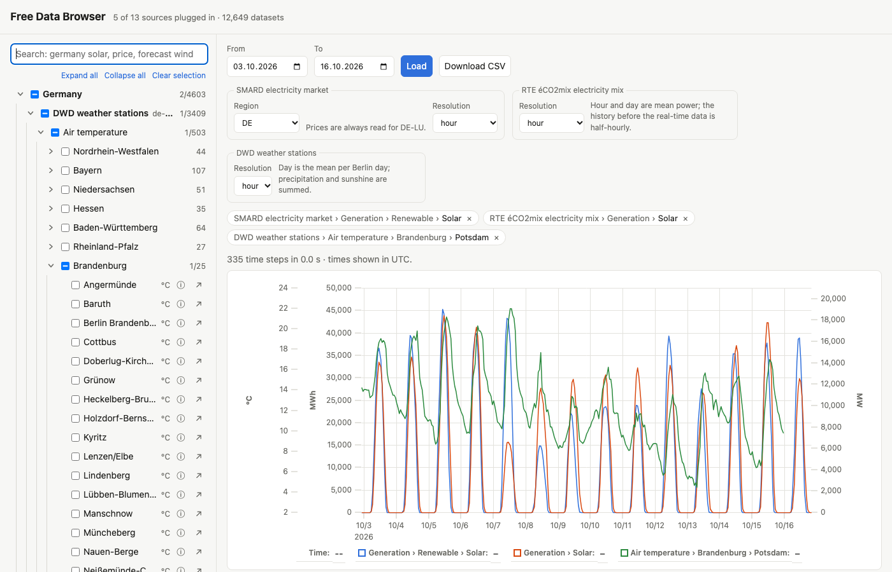

# free-data

Free public time series from German and French sources: a catalog of
sources, plugins that read them into one table format, a local file cache,
and a browser page to search, plot and export them.

## Setup

    python -m venv .venv
    .venv/bin/pip install -e ".[test]"

`pip install .` (or a wheel from `python -m build`) installs the `free_data`
package with the browser page and the source catalog included.

Python 3.11 or newer; the only dependency is numpy.

## Use

    free-data                             # the browser, then open http://127.0.0.1:8050
    free-data-smard --list                # SMARD series ids
    free-data-smard 410 4169 --start 2024-01-01 --end 2024-12-31 --out load.csv
    free-data-eco2mix --list              # RTE éCO2mix fields
    free-data-eco2mix consommation taux_co2 --resolution day --start 2024-01-01
    free-data-pegelonline --list rhein    # gauging stations, by name or water
    free-data-pegelonline KÖLN/W KÖLN/Q --resolution native
    free-data-hubeau --list seine paris   # French river gauges
    free-data-hubeau F700000103/Q --start 2016-05-01 --end 2016-06-30
    free-data-dwd --list potsdam          # DWD weather stations
    free-data-dwd 03987/TT_TU 03987/R1 --resolution day --start 2025-07-01
    free-data-cache                       # what is cached, per source
    free-data-cache clear de-smard --older-than 30d

Each command is also `python -m free_data.<module>` (`python -m free_data`
is the browser).

The browser lists every source in `src/free_data/data/`; those with a plugin can be
plotted, also several sources side by side (one axis per unit), and
downloaded as CSV. A source's first list of datasets can take up to a
minute (Hub'eau's station list); it is cached for a day. The browser binds
to 127.0.0.1 and has no authentication.

## Layout

All Python code is in the package `src/free_data/`:

| File | What it does |
| --- | --- |
| `data/<id>.json` | One source: id, link, description. |
| `sources.py` | The plugin interface (`Plugin`, `Dataset`, `Option`, `Table`), discovery and the catalog. |
| `vocabulary.py` | The shared terms for series metadata: variables, measures, regions. |
| `plugins/` | One module per readable source, each with a module-level `PLUGIN`. |
| `cache.py` | Downloads, cached under `~/.cache/free-data/<source>/`. |
| `smard.py` | Reader for SMARD, the Bundesnetzagentur's electricity market data. |
| `eco2mix.py` | Reader for RTE éCO2mix, France's electricity mix (via ODRÉ). |
| `pegelonline.py` | Reader for PEGELONLINE, the gauges of the German federal waterways (last 31 days only). |
| `hubeau.py` | Reader for Hub'eau, the river gauges of France (daily flows for decades, the rest 30 days). |
| `dwd.py` | Reader for the DWD's hourly weather observations at German stations. |
| `browser.py` | The local web server: the page and its JSON/CSV API. |
| `web/` (top level) | The page: `index.html`, TypeScript in `src/`, compiled to `dist/` (committed; both ship in the wheel). |

The readers' command lines take inclusive dates in the source's timezone
(a bare end date means the whole day) and default to the last 30 days.

A `Table` has UTC `datetime64[ms]` times, strictly increasing, and float64
values with NaN for gaps. Dates without a UTC offset are read in the
source's own timezone.

## Series metadata

Besides its label and unit, every dataset says what it measures in shared
terms, so series from different sources can be found and related:

- `variable`: from `vocabulary.VARIABLES`, dotted and nested, e.g.
  `electricity.generation.solar` (SMARD and éCO2mix alike) or
  `water.discharge` (PEGELONLINE and Hub'eau alike), with German, French
  and English synonyms and, where one exists, the CF standard name or
  ENTSO-E production type;
- `measure`: what kind of number it is (power, energy, price, level, …);
- `kind`: observation, forecast or estimate;
- `place`: country, NUTS region, name, coordinates and river where known;
- `resolution`, `since` and `quality`.

The browser uses them: the search also finds a series by its variable's
synonyms, its place, region, country and river, in German, French or
English and without accents ("niederschlag brandenburg", "debit seine");
filters narrow by country, region, variable, kind and length of history.

`relations.py` relates series through the same fields, with no list of
individual series: other variables at the same station, forecasts and what
they forecast, the same variable elsewhere (nearest first), and drivers
and effects from a short list of links between variables (sunshine and
solar generation, rain and river flow, residual load and price), nearby or
in the same country. `GET /api/related?d=<source>:<dataset>` returns them
with a reason each, and the page shows them under the selection.

`tests/test_vocabulary.py` checks that every plugin only uses terms from
`vocabulary.py`. A new plugin fills these fields in its `datasets()`; a new
term goes into `vocabulary.py` first.

## Adding a source

1. Add `src/free_data/data/<country>-<name>.json` with `data-source-id`, `link` and `description`.
2. Add `src/free_data/plugins/<country>_<name>.py` defining a `Plugin` subclass whose `id`
   matches the JSON file, and `PLUGIN = YourPlugin()`. See the docstring of
   `sources.py` and `plugins/de_smard.py`.
3. Download through `cache.Cache(<id>)`, choosing a `max_age` per file by how
   much it can still change.

## The browser page

The page is TypeScript in `web/src`, compiled by `tsc` to plain ES modules
in `web/dist`, which the browser loads directly (no bundler). `web/dist` is
committed, so running the browser needs only Python; changing the page
needs Node:

    cd web && npm install && npm run build    # or: npm run watch

All Python code is in the package `src/free_data/`:

| File | What it does |
| --- | --- |
| `src/types.ts` | The contract with the server: `SourceInfo`, `Dataset`, `Option`, `SeriesResponse`, mirroring `sources.py`. |
| `src/api.ts` | A typed client for `/api/*`. |
| `src/plugins.ts` | The `FrontendPlugin` interface and its registry. |
| `src/plugins/` | One frontend plugin per source that needs one, listed in `index.ts`. |
| `src/state.ts`, `tree.ts`, `selection.ts`, `chart.ts`, `main.ts` | The page itself. |

A frontend plugin is optional and only changes how a source looks; what a
source offers and how it is read stays in its Python plugin. Its hooks:

- `series(column, color)`: how a series is drawn, e.g. stepped lines for
  SMARD prices, bars for DWD precipitation, points for wind direction;
- `format(value, column)`: a value in the legend, e.g. "225° (SW)" or
  "-1,315 MW (export)";
- `details(dataset)`: extra content under a dataset's description.

To add one, write `web/src/plugins/<source id>.ts` exporting a
`FrontendPlugin`, add it to `web/src/plugins/index.ts` and build.

## Cache

Files live in `$XDG_CACHE_HOME/free-data` (by default `~/.cache/free-data`);
set `FREE_DATA_CACHE` to put them elsewhere. A file is fetched again once it is older than its reader's
`max_age`. If the source can't be reached or answers with a server error,
the download is tried twice more, then the cached copy is used with a warning.

## Tests and linting

    .venv/bin/pip install -e ".[test,lint]"
    .venv/bin/python -m pytest
    .venv/bin/ruff check .

The tests run offline against a temporary cache; any download attempt fails
them. GitHub Actions (`.github/workflows/tests.yml`) runs ruff, and the tests
on Python 3.11 and 3.14, on every push and pull request; it also builds
`web/` and fails if the committed `web/dist` doesn't match `web/src`.
